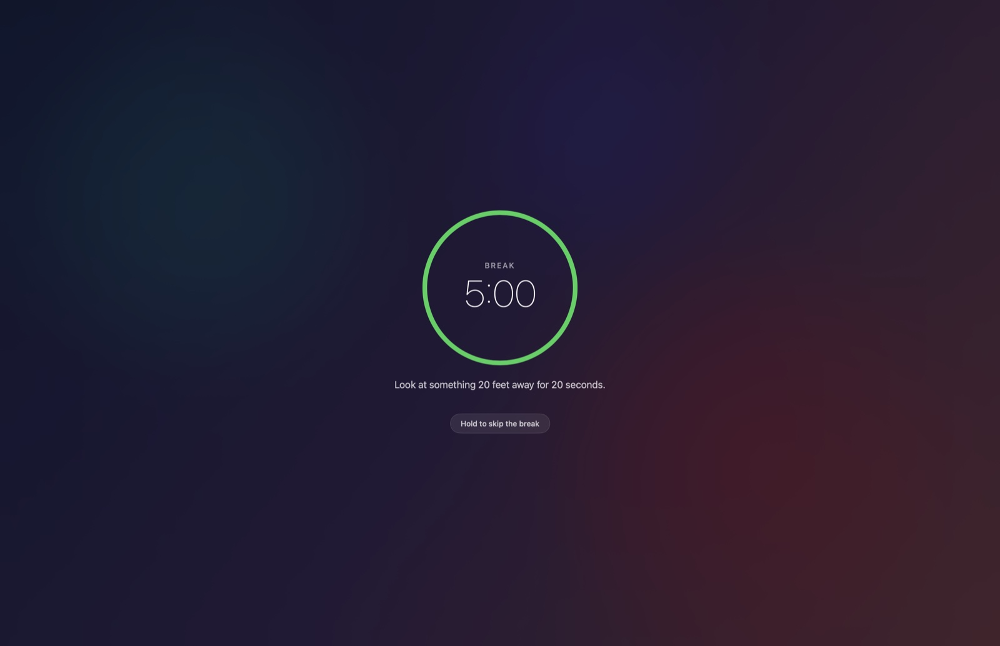
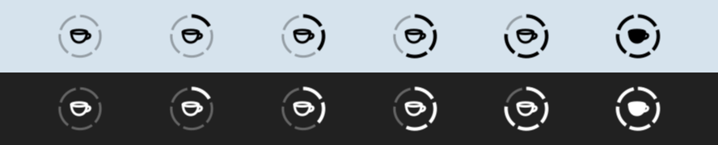
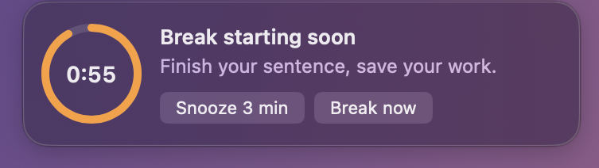

# Break

A tiny macOS menu bar app that enforces a 5-minute break every 25 minutes.



| Menu bar icon: the ring fills up as the break approaches | One-minute warning, top-right of the screen |
| :---: | :---: |
|  |  |

- **Menu bar icon**: a cup inside a ring of five segments that fill up as the break approaches.
- **Warning** one minute before the break: a floating panel with a countdown, plus *Snooze* (3 min) and *Break now* buttons.
- **Break**: every display is covered; the Dock, the menu bar, ⌘Tab, ⌘Q and Force Quit are disabled. Skipping the break requires **holding** the button for 3 seconds.
- **Break over**: the screen stays locked until you click “Resume” (or press ↩︎), which starts a new 25-minute cycle.
- **Disable** from the menu bar for 30 minutes, 1 hour, 2 hours, until tomorrow, or until you turn it back on.
- If the session is locked or the Mac sleeps for longer than a break, the 25-minute cycle starts over.
- Durations, sounds and launch at login are configurable in **Settings…**.
- Available in English and French (follows the system language).

Requirements: macOS 14 (Sonoma) or later, Apple Silicon or Intel.

## Build

Requires Xcode or the Command Line Tools (`xcode-select --install`):

```sh
./scripts/build.sh      # → build/Break.app and build/Break.zip
./scripts/install.sh    # installs build/Break.app into ~/Applications
```

The app is always universal (Apple Silicon + Intel). The build script calls `swiftc` directly and the code avoids SwiftUI macros such as `@State`, so it also builds with Command Line Tools installs that cannot read `Package.swift` or lack SwiftUI’s macro plugins. `Package.swift` is still used for `swift test` and for opening the project in Xcode.

Run the tests:

```sh
swift test
```

To run a full cycle quickly, make a “minute” shorter than 60 seconds:

```sh
BREAK_SECONDS_PER_MINUTE=2 BREAK_DEBUG=1 build/Break.app/Contents/MacOS/Break
```

## Localization

UI strings are written in English in the code; translations live in `Resources/<language>.lproj/Localizable.strings`.
